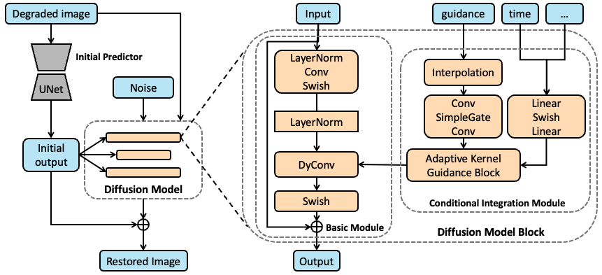
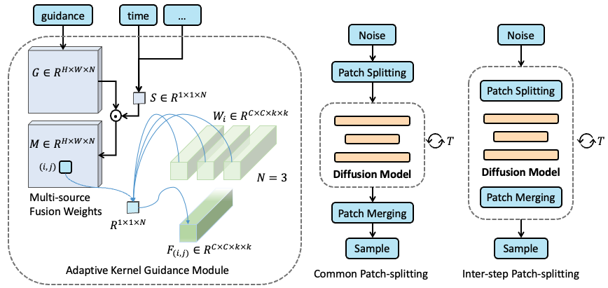

<div align="center">

# UCDIR: A Unified Conditional Framework for Diffusion-based Image Restoration

[](https://arxiv.org/abs/2305.20049)
[](https://opensource.org/licenses/MIT)
[](https://www.python.org/downloads/)

[Project Page](https://zhangyi-3.github.io/project/UCDIR) • [Paper](https://arxiv.org/abs/2305.20049) • [Citation](#citation)

</div>

---

## 📖 Abstract

Diffusion Probabilistic Models (DPMs) have recently shown remarkable performance in image generation tasks, capable of generating highly realistic images. When adopting DPMs for image restoration tasks, the crucial aspect lies in how to integrate the conditional information to guide the DPMs to generate accurate and natural output, which has been largely overlooked in existing works.

In this paper, we present a **unified conditional framework** based on diffusion models for image restoration. We leverage a lightweight UNet to predict initial guidance and the diffusion model to learn the residual of the guidance. By carefully designing the basic module and integration module for the diffusion model block, we integrate the guidance and other auxiliary conditional information into every block of the diffusion model to achieve **spatially-adaptive generation conditioning**. To handle high-resolution images, we propose a simple yet effective **inter-step patch-splitting strategy** to produce arbitrary-resolution images without grid artifacts. 

We evaluate our conditional framework on three challenging tasks: **extreme low-light denoising**, **deblurring**, and **JPEG restoration**, demonstrating significant improvements in perceptual quality and generalization to restoration tasks.

---

## 🎯 Key Features

- ✨ **Unified Conditional Framework**: A novel approach to integrate conditional information into diffusion models for image restoration
- 🎨 **Spatially-Adaptive Conditioning**: Guidance and auxiliary conditions integrated into every diffusion block
- 📐 **High-Resolution Support**: Inter-step patch-splitting strategy for arbitrary-resolution images without grid artifacts
- 🚀 **State-of-the-Art Performance**: Superior results on extreme low-light denoising, deblurring, and JPEG restoration tasks

---

## 🏗️ Network Architecture

<div align="center">
  
  <br>
  
</div>

---

## 📋 Table of Contents

- [Installation](#-installation)
- [Training](#-training)
- [Evaluation](#-evaluation)
- [Results](#-results)
- [Citation](#-citation)
- [Contact](#-contact)
- [Acknowledgments](#-acknowledgments)

---

## 🚀 Installation


### Setup

```bash
# Clone the repository
git clone https://github.com/yourusername/UCDIR.git
cd UCDIR

# Install dependencies
pip install -r requirements.txt
pip install lpips clean-fid

# (Optional) Install BasicSR for additional features
# python setup.py develop --no_cuda_ext
```

---

## 🎓 Training

```bash
# Training instructions coming soon
# Stay tuned for updates!
```

> **Note:** Training code and detailed instructions will be released soon.

---

## 📊 Evaluation

### SID (See-in-the-Dark) Dataset

#### 1. Download Models and Data

- **Model**: Download the [denoising model](https://pan.baidu.com/s/1Sfocl0tPMlLRj0VBF1nUEA?pwd=uwi7) and place it in `./experiments/sid/checkpoint/`
- **Dataset**: Download the [testing dataset](https://pan.baidu.com/s/1nZIYN4LAHTTon0jG9faFnQ?pwd=1sx2) and place it in `./dataset/`

#### 2. Run Inference

```bash
CUDA_VISIBLE_DEVICES=0,1,2,3,4,5,6,7 python -m torch.distributed.launch \
    --nproc_per_node=8 --master_port=4321 \
    python -u sr.py -p val -c config/sid.yaml \
    --checkpoint experiments/sid/checkpoint/I_Elatest
```

#### 3. Evaluate Results

Download the [SID results](https://pan.baidu.com/s/1Sfocl0tPMlLRj0VBF1nUEA?pwd=uwi7) from our paper and place them in `./experiments/val_sid-ema-s50/results/`

```bash
# Calculate PSNR, SSIM, LPIPS, FID, and KID metrics
python -u eval1.py -s experiments/val_sid-ema-s50/results
```

---

## 📈 Results

Our method achieves state-of-the-art performance on multiple image restoration tasks. For detailed quantitative and qualitative results, please refer to our [paper](https://arxiv.org/abs/2305.20049).

---

## 👥 Authors

- [Yi Zhang](https://zhangyi-3.github.io/)<sup>1</sup>
- [Xiaoyu Shi](https://scholar.google.com/citations?user=fbEuTJUAAAAJ&hl=en)<sup>1</sup>
- [Dasong Li](https://dasongli1.github.io/)<sup>1</sup>
- [Xiaogang Wang](https://scholar.google.com/citations?user=-B5JgjsAAAAJ)<sup>1</sup>
- [Jian Wang](https://jianwang-cmu.github.io/)<sup>2</sup>
- [Hongsheng Li](https://www.ee.cuhk.edu.hk/~hsli/)<sup>1</sup>

<sup>1</sup>The Chinese University of Hong Kong  
<sup>2</sup>Snap Research

---

## 📝 Citation

If you find this work useful for your research, please cite:

```bibtex
@article{zhang2023UCDIR,
  title={A unified conditional framework for diffusion-based image restoration},
  author={Zhang, Yi and Shi, Xiaoyu and Li, Dasong and Wang, Xiaogang and Wang, Jian and Li, Hongsheng},
  journal={Advances in Neural Information Processing Systems},
  volume={36},
  pages={49703--49714},
  year={2023}
}
```

---

## 📧 Contact

For questions and inquiries, please contact: **zhangyi@link.cuhk.edu.hk**

---

## 🙏 Acknowledgments

This project is built upon the following excellent works:

- [BasicSR](https://github.com/xinntao/BasicSR) - Open source image and video restoration toolbox
- [S3](https://github.com/Janspiry/Image-Super-Resolution-via-Iterative-Refinement) - Image Super-Resolution via Iterative Refinement

---

<div align="center">

**⭐ If you find this project helpful, please consider giving it a star! ⭐**

</div>
